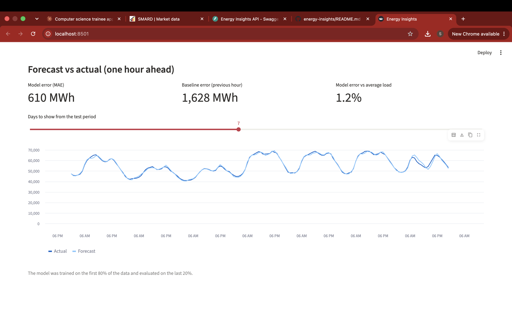

# Energy Insights


Forecasting German electricity grid load with Python: data pipeline, forecasting model, secured REST API, dashboard and Docker image.

## What it does

- Loads two years of hourly German grid load data (Nov 2024 to Nov 2026, 17,568 values) from SMARD
- Trains a one-hour-ahead forecasting model with scikit-learn (see `notebooks/01_explore.ipynb`)
- Stores the data in a SQLite database and serves it through a REST API built with FastAPI
- Protects the data with user login (hashed passwords, token authentication, input validation)
- Interactive Streamlit dashboard with grid load charts and a forecast backtest
- Automated tests (pytest) and a GitHub Actions pipeline that runs the tests and a dependency vulnerability scan on every push
- Docker image for the API

## Dashboard




## Forecast results

Tested on the last 20% of the period, which the model did not see during training.

| Model | Mean absolute error | Share of average load |
|---|---|---|
| Baseline (same as previous hour) | 1,628 MWh | 3.2% |
| Gradient boosting (lag 1, 24, 168 hours, hour, weekday) | 607 MWh | 1.2% |

## API endpoints

| Endpoint | Login required | Description |
|---|---|---|
| `GET /health` | No | Health check |
| `POST /register` | No | Create an account |
| `POST /login` | No | Returns an access token |
| `GET /consumption` | Yes | Latest values; optional `limit`, `start`, `end` |
| `GET /consumption/stats` | Yes | Count, average, minimum and maximum |

Interactive documentation is available at `/docs` when the API is running. Use the Authorize button there to paste your token.

## Security

- Passwords are hashed with bcrypt and never stored in plain text
- Access tokens (JWT) expire after 30 minutes
- Data endpoints require a valid token
- Input validation: username and password length and allowed characters, limits on query parameters
- The token signing key is read from the `SECRET_KEY` environment variable, and the app refuses to issue tokens without it
- A GitHub Actions step scans the dependencies for known vulnerabilities (pip-audit) on every push

Known limitations: registration is open (the data is public SMARD data), there is no rate limiting on login yet, and HTTPS has to be provided by the hosting platform.

## Run it locally

```bash
git clone https://github.com/Saju-Anmariya/energy-insights.git
cd energy-insights
python3 -m venv .venv
source .venv/bin/activate
pip install -r requirements.txt
python -m scripts.load_data
export SECRET_KEY="$(python -c 'import secrets; print(secrets.token_urlsafe(32))')"
uvicorn app.main:app --reload
```

Dashboard: `python -m streamlit run dashboard/streamlit_app.py`

Tests: `pytest`

## Run with Docker

```bash
docker build -t energy-insights-api .
docker run -p 8000:8000 -e SECRET_KEY="$SECRET_KEY" energy-insights-api
```

The data is loaded into the image at build time. User accounts live in the container's own database and are lost when the container is removed.

## Project structure

```
app/          FastAPI application, database, authentication and forecast code
dashboard/    Streamlit dashboard
scripts/      Script that loads the CSV data into the database
notebooks/    Data exploration and forecasting model
tests/        Automated tests
data/raw/     SMARD data (CSV)
docs/         Screenshots
.github/      GitHub Actions pipeline
Dockerfile    Container image for the API
```

## Roadmap

- Cloud deployment
- Rate limiting on login
- Day-ahead forecasting

## Data source

Bundesnetzagentur | SMARD.de