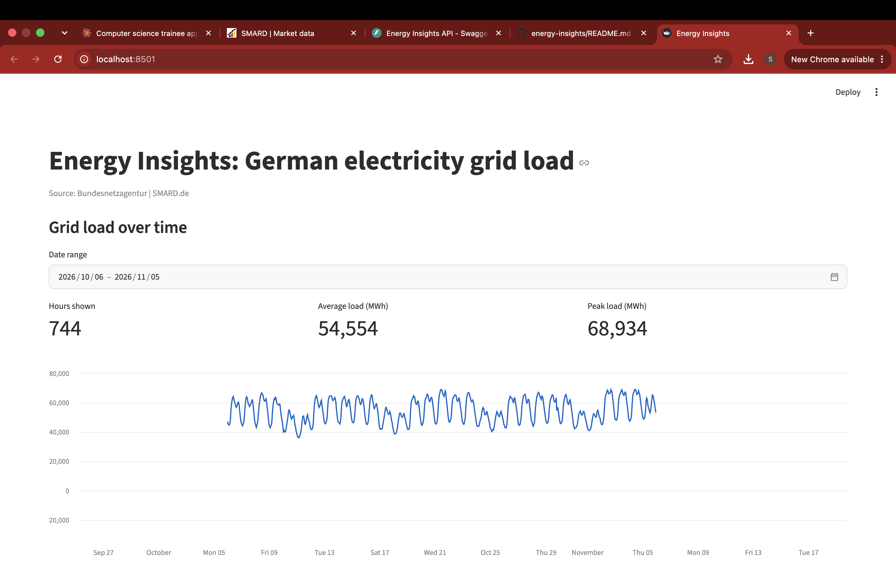

# energy-insights# Energy Insights

Forecasting German electricity grid load with Python: data pipeline, forecasting model and REST API.

## What it does

- Loads two years of hourly German grid load data (Nov 2024 to Nov 2026, 17,568 values) from SMARD
- Trains a one-hour-ahead forecasting model with scikit-learn (see `notebooks/01_explore.ipynb`)
- Stores the data in a SQLite database and serves it through a REST API built with FastAPI
- Covered by automated tests (pytest) that run against a temporary database
- Interactive Streamlit dashboard with grid load charts and forecast backtest

## Dashboard



## Forecast results

Tested on the last 20% of the period, which the model did not see during training.

| Model | Mean absolute error | Share of average load |
|---|---|---|
| Baseline (same as previous hour) | 1,628 MWh | 3.2% |
| Gradient boosting (lag 1, 24, 168 hours, hour, weekday) | 607 MWh | 1.2% |

## API endpoints

| Endpoint | Description |
|---|---|
| `GET /health` | Health check |
| `GET /consumption` | Latest values; optional `limit`, `start`, `end` |
| `GET /consumption/stats` | Count, average, minimum and maximum |

Interactive documentation is available at `/docs` when the API is running.

## Run it locally

```bash
git clone https://github.com/Saju-Anmariya/energy-insights.git
cd energy-insights
python3 -m venv .venv
source .venv/bin/activate
pip install -r requirements.txt
python -m scripts.load_data
uvicorn app.main:app --reload
```

Run the tests with `pytest`.

## Project structure

```
app/        FastAPI application, database setup and models
scripts/    Script that loads the CSV data into the database
notebooks/  Data exploration and forecasting model
tests/      Automated API tests
data/raw/   SMARD data (CSV)
```

## Roadmap

#- Streamlit dashboard with charts and forecast
- Docker image and GitHub Actions pipeline
- Cloud deployment
- Security hardening: login with password hashing, input validation, dependency scanning

## Data source

Bundesnetzagentur | SMARD.de